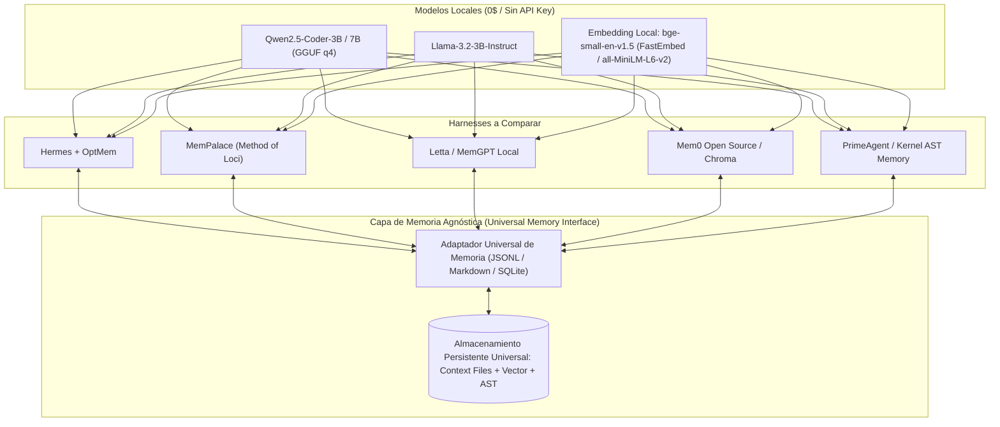

# Plan de Pruebas: Evaluación de Memoria Agnóstica en Harnesses de Agentes con Modelos Sin API Key (100% Locales y Gratuitos)

## 1. Contexto y Restricciones del Proyecto
El profesor ha establecido un **requisito y constraint fundamental**: 
> **"La memoria debe ser agnóstica"**: La capa de memoria (almacenamiento, indexación, jerarquía, recuperación semántica o espacial) no debe depender de un modelo propietario específico (ej. GPT-4o, Claude 3.5 Sonnet) ni de un harness cerrado. Debe poder conectarse e intercambiarse entre diferentes harnesses y operar exclusivamente con **modelos abiertos, locales y sin API Key** (sin suscripciones, sin pago por tokens, ejecutables en hardware local/académico vía Ollama / llama.cpp / Hugging Face).

### Especificaciones del Entorno Local Detectado
- **CPU**: Intel Core i5-8350U (8 vCPUs @ 1.70GHz)
- **RAM**: ~14 GiB disponible (10 GiB libres)
- **Aceleración**: CPU-only (sin GPU dedicada en esta máquina local; se pueden usar modelos cuantizados GGUF `q4_k_m` de 1.5B, 3B y 7B optimizados para CPU o servidores de laboratorio/colab local).

---

## 2. Definición Arquitectural: ¿Qué es una Memoria Agnóstica?

Una memoria es **agnóstica** si cumple con los siguientes principios:
1. **Desacoplamiento del LLM (*Model-Agnostic*)**: El formato de memoria no asume prompts propietarios ni funciones cerradas (ej. no depende de "OpenAI function calling" o "Claude computer use").
2. **Desacoplamiento del Harness (*Harness-Agnostic*)**: La misma base de conocimiento puede ser leída/escrita por **Hermes**, **MemPalace**, **Letta (MemGPT)**, **Mem0** o un harness custom mediante una interfaz estándar (archivos planos, SQLite, o API REST/gRPC local).
3. **Cero Dependencia de Servicios Pagados (*Zero-Cost & Zero-API-Key*)**: La extracción de entidades, el embedding vectorial y el razonamiento se realizan con modelos open-weight locales o métodos deterministas/lexicales (BM25, Tree-sitter, regex).

---

## 3. Matriz de Harnesses y Modelos Sin API Key

| Harness / Sistema | Mecanismo de Memoria | Modelo de Embeddings (Gratuito/Local) | LLMs Locales Recomendados (Sin API Key) | Soporte de Contexto Local |
| :--- | :--- | :--- | :--- | :--- |
| **Hermes + OptMem** | Archivos curados (`MEMORY.md`, `USER.md`) + BM25/Regex | No requiere embeddings (100% Determinista / BM25) | `Qwen2.5-Coder-3B` / `Llama-3.2-3B` vía Ollama | Altísimo (Cero degradación de caché, costo de cómputo mínimo) |
| **MemPalace** | Espacial (Alas $\to$ Pasillos $\to$ Armarios $\to$ Cajones) + *Loci* | `bge-small-en-v1.5` o BM25 híbrido local | `Qwen2.5-Coder-7B` / `DeepSeek-R1-Distill-Qwen-1.5B/7B` | Excelente (~170 tokens en boot; recuperación focalizada) |
| **Letta (MemGPT Local)** | Memoria jerárquica (Core Memory, Archival, Recall) | `all-MiniLM-L6-v2` vía ChromaDB local | `Qwen2.5-Coder-7B-Instruct` o `Mistral-7B-Instruct` vía Ollama | Variable (Sensible al formato de function-calling local) |
| **Mem0 (Open-Source)** | Extracción de grafos y vectores persona/código | `SentenceTransformers` local (`all-MiniLM-L6-v2`) | `Qwen2.5-Coder-3B` / `Llama-3.2-3B` | Bueno, pero intensivo en CPU en la fase de extracción |
| **AST / PrimeAgent** | Grafo de símbolos de código (Tree-sitter) + Scratchpad | Determinista (Árbol sintáctico sin LLM) | `Qwen2.5-Coder-3B` / `7B` | Óptimo para repositorios (resolución determinista de llamadas) |

---

## 4. Benchmarks Seleccionados para la Evaluación

Se probarán 4 benchmarks orientados específicamente a **código y persistencia temporal** con métricas automáticas (sin necesidad de LLM-as-a-judge comercial):

1. **LongMemCode (Monorepo Code Memory Benchmark)**:
   - *Objetivo*: Evaluar la capacidad de recuperar dependencias y funciones en un monorepo extenso (>1,000 archivos) a través de múltiples sesiones consecutivas.
   - *Métrica*: Recall@k, Tasa de acierto de símbolo, Latencia de consulta (segundos en CPU).
2. **RepoQA (Needle in a Haystack de Funciones)**:
   - *Objetivo*: Localizar una función específica a partir de su descripción o comportamiento sin conocer su nombre ni ruta exacta.
   - *Métrica*: Top-1 Retrieval Accuracy, Token Cost por búsqueda.
3. **SWE-bench Lite (Subconjunto de Resolución de Issues)**:
   - *Objetivo*: Probar si el harness recuerda el contexto de archivos modificados previamente al intentar resolver un bug multi-archivo.
   - *Métrica*: % de archivos editados correctamente, persistencia de memoria entre pasos de depuración.
4. **LoCoMo / LongMemEval (Memoria Temporal y Consistencia)**:
   - *Objetivo*: Medir la retención de preferencias del usuario y convenciones del proyecto tras 20, 50 y 100 turnos de interacción simulada.
   - *Métrica*: Tasa de contradicción (Conflict Rate), Precisión de recuperación temporal.

---

## 5. Diseño del Plan de Pruebas (Fases de Ejecución)

### Fase 1: Estandarización de la Capa de Memoria Agnóstica
- Diseñar un esquema de almacenamiento agnóstico:
  - Formato universal en disco: `workspace/.memory/` con metadatos en JSONL y notas en Markdown estructurado.
  - Implementar un adaptador de lectura/escritura unificado en Python para que cualquier harness lea y escriba bajo el mismo contrato.

### Fase 2: Configuración del Stack de Inferencia 100% Gratuito y Local
- Instalación de **Ollama** o motor liviano `llama.cpp` (vía script local).
- Descarga de modelos cuantizados optimizados para 14 GB RAM:
  - `qwen2.5-coder:3b` (~2.0 GB RAM) - Para pruebas ultra-rápidas en CPU.
  - `llama3.2:3b` (~2.0 GB RAM) - Para comparación cruzada.
  - `qwen2.5-coder:7b-q4_k_m` (~4.7 GB RAM) - Para tareas complejas de código.
- Embeddings locales: `BAAI/bge-small-en-v1.5` o `all-MiniLM-L6-v2` vía `fastembed` (Cero GPU requerida).

### Fase 3: Protocolo de Pruebas Cruzadas (Cross-Testing Matrix)
Para cada harness $H \in \{\text{Hermes/OptMem, MemPalace, Letta, Mem0, AST}\}$:
1. **Test 1: Inicialización y Consumo de Recursos (Baseline)**:
   - Memoria RAM base consumida.
   - Tiempo de indexación inicial de un repositorio de prueba (ej. mini-repo de 50 archivos Python).
2. **Test 2: Recuperación de Código (LongMemCode / RepoQA)**:
   - Inyección de 20 "needles" (funciones críticas con firmas particulares).
   - Ejecución de 20 preguntas con LLM local pidiéndole refactorizar o reutilizar la función.
   - Medir si el contexto inyectado al LLM contiene el código correcto.
3. **Test 3: Resistencia al Olvido y Persistencia Multi-Sesión**:
   - Sesión 1: Declarar convención del proyecto ("Todas las funciones deben usar snake_case y type hints con pydantic v2").
   - Sesiones 2 a 15: Tareas no relacionadas de código.
   - Sesión 16: Solicitar creación de un nuevo módulo y evaluar si aplica la convención almacenada.
4. **Test 4: Portabilidad Agnóstica (Transfer Test)**:
   - Crear la memoria usando el Harness A (ej. MemPalace).
   - Cambiar al Harness B (ej. Hermes) sin reindexar y evaluar si puede recuperar y operar sobre la memoria existente.

### Fase 4: Integración de Resultados en el Dashboard HTML
- Incorporar una nueva vista o pestaña interactiva en `index.html`:
  - **Simulador de Matriz de Pruebas**: Comparativa visual con filtros por tamaño de modelo local (1.5B, 3B, 7B).
  - **Calculadora de Requisitos de Hardware**: RAM requerida vs tipo de memoria.
  - **Guía de Reproducibilidad para el Profesor**: Comandos exactos listos para copiar y pegar para ejecutar las pruebas sin gastar un solo centavo ni usar API Keys.

---

## 6. Plan de Verificación

### Pruebas Automatizadas
1. **Script de Benchmark de Portabilidad (`test_agnostic_memory.py`)**:
   - Verifica que los datos exportados por un sistema puedan ser cargados por el adaptador universal.
2. **Medición de Latencia y Consumo de Tokens**:
   - Medir el tiempo de ejecución en CPU con los modelos locales de Ollama.
3. **Validación del Dashboard HTML**:
   - `python3 -m http.server` + verificación de que no hay enlaces externos rotos ni dependencias de internet.

### Verificación Manual
- El usuario podrá revisar el informe interactivo en `index.html` o la suite de scripts en `/home/nat/my-repo` para presentar directamente los resultados y el diseño metodológico a su profesor.
